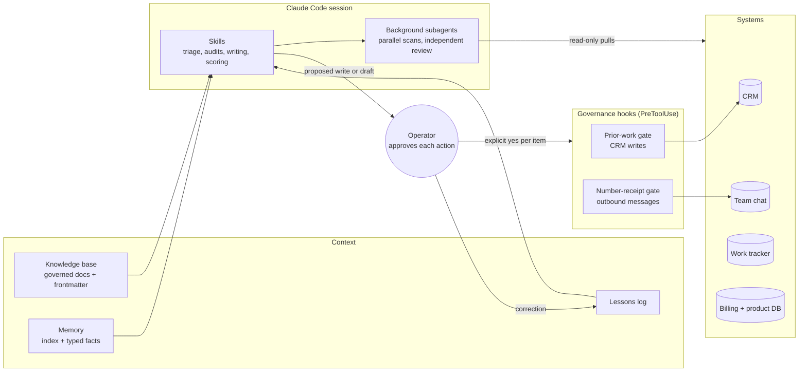

# AI RevOps OS

How one revenue operations lead runs RevOps for a B2B SaaS company through an AI operating system built on Claude Code.

This repo is a clean-room, anonymized version of a system I built and run day to day. Every company, person, ID and number in it is fictional ("Acme Research", a made-up B2B research software company). The patterns, guardrails and code structure are real.

## The idea

A first RevOps hire usually covers CRM admin, routing, attribution, reporting, forecasting, comp and enablement alone. I treat that as a systems problem:

- **Context lives in files, not in heads.** A governed knowledge base (strategy, definitions, rulings, playbooks) and a typed memory of decisions and incidents give the AI the same context a long-tenured operator would have.
- **Repeatable work becomes a skill.** Triage, audits, scoring, reporting and writing checks are packaged as skills with clear triggers, steps and output formats.
- **Risky actions go through gates, not good intentions.** Hooks block CRM writes and outbound messages until the evidence they depend on has been checked.
- **Mistakes become rules.** Every correction is logged as a lesson, and recurring lessons turn into hooks or skill steps.

## Architecture



## Human-in-the-loop principles

These are the operating rules the system enforces, through hooks where possible and skill steps where not.

1. **Suggest, don't act.** Scans and audits are read-only. They end in a proposed action, never an action.
2. **Draft is not send.** Anything a colleague or customer can see is drafted for the operator, who sends it.
3. **One approval covers one item.** "Looks good" on a plan does not approve a message or a bulk write inside it.
4. **Bulk writes follow a fixed procedure:** fresh pull, before-audit file, prior-work lookup on every record, one test record with read-back, the batch, a full read-back, and a rollback file of every prior value.
5. **Every claim is labeled.** CHECKED means seen in a tool result this session. ASSUMED means anything else (memory, docs, how it usually works). ASSUMED never goes into a colleague-facing message.
6. **Numbers need receipts.** A number in an outbound message needs a fresh receipt saying where it came from and when it was checked.
7. **Corrections become lessons the same day,** and repeated lessons become gates.

## Repo map

| Path | What it shows |
|---|---|
| [`governance/`](governance/) | Two working PreToolUse hooks: a prior-work gate for CRM writes and a number-receipt gate for outbound messages, plus the settings snippet that wires them in |
| [`skills/`](skills/) | Seven skills: daily triage, AI-tell auditor (with a runnable script), writing rules, task workflow, deep planning, draft scoring, close-reason compliance |
| [`memory-pattern/`](memory-pattern/) | A file-based memory template (index + typed memory files) and a lessons log with example lessons |
| [`examples/crm-cleanup/`](examples/crm-cleanup/) | Runnable case study on synthetic data: find contacts with an email in First name, restore real names from history, clear the rest, with audit, test record, read-back and rollback |
| [`examples/win-loss-method/`](examples/win-loss-method/) | Win/loss method on a synthetic dataset: loss share by stage with Wilson confidence intervals |
| [`examples/revenue-dashboard/`](examples/revenue-dashboard/) | Runnable Next.js revenue dashboard on synthetic data: daily snapshot pull, exec summary, cohort funnel, forecast, data-quality scorecard, definitions page from `rules.md`, page ownership via `owners.json` + `CODEOWNERS` |
| [`docs/knowledge-base.md`](docs/knowledge-base.md) | How the governed knowledge base is organized: folders, frontmatter, synthesis vs detail docs |

## Running the examples

The Python examples need Python 3.9+ and the standard library only. The dashboard needs Node 20+.

```bash
cd examples/crm-cleanup && python3 make_mock_crm.py && python3 cleanup.py --apply && cd ../..
cd examples/win-loss-method && python3 winloss.py && cd ../..
echo "Honestly, here's the unlock." | python3 skills/ai-tell-auditor/scripts/audit.py
cd examples/revenue-dashboard && npm install && npm run build && npm start
```

## About

Built by Nick Maffei, revenue operations. The production version of this system runs against a real CRM, chat workspace, work tracker, billing system and product database. None of that data is here.

License: MIT.
