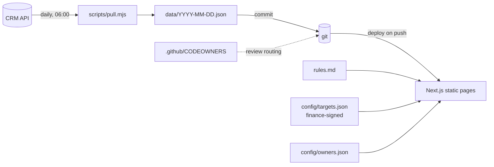

# Revenue dashboard (example)

A clean-room rebuild of the revenue dashboard I run in production, on synthetic data for a fictional company, Acme Research. Same architecture, much smaller.

## Architecture



Why it is built this way:

- **Pages never call the CRM.** A daily job pulls once, computes the model, and writes a dated JSON snapshot. Pages read the latest snapshot at build time. The dashboard is fast, cheap, and every number on it is reproducible from a file in git.
- **Snapshots are history.** Because every day's snapshot is committed, "what did we think on the 3rd?" is a git checkout, and restated numbers are visible as diffs.
- **Definitions are code and prose at once.** `rules.md` is the canonical definition of every metric and renders as the Definitions page. `app/lib/model.ts` implements exactly what `rules.md` says, and the two change together.
- **Every page has an owner.** `config/owners.json` puts an owner chip in each page header (who answers for these numbers). `.github/CODEOWNERS` routes code review on the same paths to the same people. Targets need a finance reviewer.

## Pages

| Page | What it answers |
|---|---|
| Exec summary | Where the quarter stands against target, and whether the data can be trusted |
| Funnel | Volume by month, and cohort conversion (MQL to SAL, SAL to SQO within 30 days, mature cohorts only) |
| Forecast | Won to date, weighted pipeline by stage, the "if every date lands" ceiling, and past-due deals kept out of the number |
| Data quality | CRM error rate by group and by check, with the weekly trend |
| Definitions | `rules.md`, rendered |

## Run it

```bash
npm install
npm run pull        # optional: writes data/<today>.json (synthetic)
npm run build
npm start           # http://localhost:3000
```

A sample snapshot (`data/2026-01-15.json`) is committed, so `npm run build` works without running the pull.

## Deploy to Vercel

1. Push this folder as its own repo (or set the Vercel project's root directory to `examples/revenue-dashboard`).
2. Import it in Vercel. The framework is detected as Next.js; `vercel.json` sets the build command and a `noindex` header.
3. Turn on the `daily-pull` GitHub Action. Each morning it commits a new snapshot and Vercel redeploys on the push.
4. For a real CRM, replace the synthetic generator in `scripts/pull.mjs` with API reads and set the token as a repository secret. Keep it server-side: the token never reaches the browser, because pages only read the snapshot.

## Dependencies

Next.js, React and TypeScript, pinned to exact versions. No chart or UI libraries: bars are CSS, and the Definitions page uses a 50-line markdown renderer.
